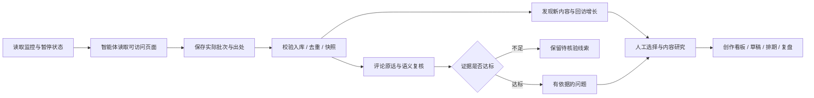

# 龙井 · 自媒体工作台

**发现新热点，听懂评论里的问题，把有依据的线索推进成内容。**

[](https://github.com/LongJingSU/longjing-creator-radar/actions/workflows/test.yml)

[](LICENSE)

龙井是一个运行在本机的中文自媒体工作台，默认关注抖音、小红书的 **AI 工具、AI 自媒体、AI 硬件**，也能留存泛流量热点。你和 AI 智能体一起工作：智能体从可访问的页面采集和核验，工作台负责保存来源、比较快照、整理评论需求、管理选题和创作进度。

**把仓库链接发给具备本地执行和浏览器能力的 AI 智能体，就能按文档安装并接入使用。** 工作台本身不内置爬虫、模型服务或定时调度器；自动采集需要你的智能体及浏览器会话，日更需要另外注册实际定时任务。


> 文档截图来自本项目真实运行的独立演示模式。截图中的内容、作者、评论、证据、指标和商单均为虚构教学数据，顶部有明确标识；不是实际采集成果，也不包含作者个人数据库。没有原始封面时，界面如实显示文字预览。

## 交给 AI，直接开始

把下面这段话和仓库链接一起发给你的智能体：

```text
请安装并使用 https://github.com/LongJingSU/longjing-creator-radar 。
先读 README.md、AGENTS.md，检查环境、运行测试并启动工作台。
按 COLLECTION.md，用你支持的浏览器工具读取我可访问的抖音和小红书，
监控 AI工具、AI自媒体、AI硬件，新热点和新爆款优先，完成首轮真实采集和入库核验。
在你的定时任务系统中设置每天北京时间12:00更新，不发例行晨报，不自动发布或发消息。
没有浏览器或调度能力时，明确说明缺口；不要编造数据、来源或选题依据。
最后打开工作台，告诉我哪些步骤已实际完成。
```

完整流程见 [AI 接手与安装指南](docs/AI-QUICKSTART.md)。不想连接平台，先体验界面，可直接使用下方演示模式。

## 本地启动

需要 **Node.js 22.13 或以上，推荐 Node.js 24**，以及现代浏览器。源码使用原生 JavaScript、Node 内置 HTTP 和 SQLite，**没有 npm 第三方依赖，无需 npm install，也无需配置应用 API key**。

```bash
git clone https://github.com/LongJingSU/longjing-creator-radar.git
cd longjing-creator-radar
node scripts/doctor.mjs
npm test
npm start
```

打开 [http://127.0.0.1:4318](http://127.0.0.1:4318)。保持服务终端运行；按 Ctrl+C 停止。第一次启动自动创建空数据库和 6 个默认关键词监控，未采集之前没有内容是正常的。

Windows 也可以双击 `打开工作台.cmd`；启动器会复用已有实例或在后台启动。macOS / Linux 使用上面的命令。若端口占用，可设置 `PORT` 后启动，例如 PowerShell：`$env:PORT=4321; npm start`，或 macOS/Linux：`PORT=4321 npm start`。Windows 双击启动器固定使用 4318。

### 先体验全部界面

```bash
npm run demo
```

打开 [http://127.0.0.1:4320](http://127.0.0.1:4320)。演示与正式应用共用前后端，但使用独立的内存数据库；可体验收藏、需求门槛、创作、商单和监控。关闭进程后演示修改丢弃，导出文件仅写入系统临时目录。它不会读取或修改正式数据库，也不会访问平台采集数据。

## 目前已有的功能

| 页面 / 能力 | 可以做什么 | 数据口径与限制 |
| --- | --- | --- |
| 今天 | 内容、评论、需求、选题概览；查看各 AI 赛道样本；进入近期内容和问题 | 赛道样本占比不是全平台指数 |
| 发现 · 爆款 | 近 24 小时、近 7 天、近期增长、历史参考、日期待核实筛选；卡片/表格、搜索、分页、批量操作 | 首次发现不等于新发布；累计高赞不等于正在爆火 |
| 发现 · 榜单 | 近期新内容、增长观察、历史累计高互动、首次采集、泛流量话题 | 各种排名口径分开显示 |
| 发现 · 来源 | 查看来源覆盖、监控配置和最近采集反馈 | 配置计划不代表已执行 |
| 内容详情 | 打开对应原视频/笔记；看日期、入口、指标、快照和评论；收藏、跟踪、推选题 | 原作品地址保留必要访问参数；平台可能要求登录 |
| 选题与需求 | 有依据的问题、待核验线索、忽略/恢复；按赛道和平台筛选；设置证据门槛 | 未达标没有选题角度，转选题按钮不可用 |
| 评论证据 | 保存原话、署名、点赞、定位说明、摘录、可选截图；逐条语义复核和重新归类 | 视频链接无法定位评论时明确提示，不伪造评论直达链接 |
| 参考 | 收藏内容、分类、拆解笔记、筛选和导出 | 保存用户自己的判断，采集不覆盖 |
| 创作 | 待研究 → 待创作 → 创作中 → 已发布；脚本、排期、发布链接、归档恢复、草稿导出 | 发布状态由用户管理，不代发内容 |
| 运营 | 选题进度、内容排期、采集覆盖、已发布作品与复盘 | 不自动抓取自己账号的经营数据 |
| 商单 | 合作方、金额、交付日期、制作/交付/回款状态、归档恢复 | 本地记录，不执行交易 |
| 账号 | 添加对标账号，从已采集作者创建监控、查看其内容 | 昵称归组不等于平台身份认证 |
| 赛道监控 | 关键词、账号、单条内容监控；启停、编辑、归档；长尾词轮换采集计划 | 每轮以最新启用配置为准 |
| 采集记录 | 新增、更新、评论数、覆盖词、排序、分析和错误缺口 | 支持部分完成与零采集失败记录 |
| 定时任务 | 采集总开关、外部任务登记状态、默认更新时间、最近执行 | 实际调度由智能体执行，页面开关不会创建任务 |
| 设置与数据 | 高互动门槛、JSON 批次导入、CSV/草稿/JSON 导出、SQLite 持久化 | JSON 快照导出不是一键全量恢复格式 |

## 为什么不随便从一条评论出选题

工作台先保留原话，再把“对象相同、含义相同”的具体问题聚合。关键词规则只能找到待核验线索，不能代替理解上下文。例如“机会成本”不能直接变成工具付费问题，“技术取代速度真快”不能变成工具选型问题。

**评论需求必须同时有语义复核、出处留证，并满足以下任一路径：**

- 多人路径：同一个具体问题，默认至少 **5 个不同平台内署名、2 个作品**。
- 高赞路径：单条明确问题，默认至少 **100 赞**，这条评论的点赞显示也要留证。

门槛可在界面调整。昵称去重存在身份局限；点赞只能说明受到关注，不等于大家认同。单条低赞问题、纯观点、作者自评、引流和重复话术不直接变成共性需求。允许一轮没有任何达标选题。


出处校验是对已保存材料的结构和一致性检查，不是系统重新登录平台背书。智能体或人工仍需真实读取页面、核对上下文；不要伪造摘录来满足规则。

## 从采集到创作的协作流程



“重新读取”刷新本机数据库，不会启动平台采集。前端没有模型调用，也没有定时爬虫；智能体按 [COLLECTION.md](COLLECTION.md) 采集后通过以下命令入库：

```bash
node scripts/ingest.mjs inbox/YYYY-MM-DD.json
node scripts/status.mjs
```

请把路径替换为实际批次文件。来源去重、评论去重与 runKey 幂等由程序处理。同一 runKey 重复导入返回旧结果；补充采集要使用新的、说明用途的 runKey。CLI 可在网页关闭时直接更新 SQLite。

## 每天 12:00 自动更新

让智能体在它自己的调度系统中创建每天北京时间 12:00 的任务，提示词和验收步骤见 [定时接入指南](docs/AUTOMATION.md)。本地“自动采集”开关会被下一轮任务读取，暂停后跳过采集。

自动执行需要设备、智能体和浏览器连接可用。浏览器失效、验证码、平台访问限制等会写入采集记录；零结果不会被解释成没有热点。成功注册调度任务与成功完成采集是两件事，必须分别验证。

## 功能截图

截图均由独立演示实例实际渲染，无个人数据。完整截图与逐页说明见 **[功能截图册](docs/SCREENSHOTS.md)**。

<details>
<summary>展开：今日概览、创作看板、监控与采集记录</summary>


</details>

## 数据保存与备份

- `data/radar.sqlite`：内容、评论、监控、快照、需求状态、笔记、选题、商单。
- `data/evidence/`：实际留存的评论截图；`data/exports/`：导出文件。
- `inbox/`：采集原始批次与验收文件。
- 上述数据和 `.env`、数据库文件均被 Git 忽略。仓库不包含作者的平台登录状态或私人采集库。

完整备份：先停止本工作台服务及采集写入，再复制整个 `data/`（包括存在的 WAL/SHM 文件），并按需备份 `inbox/`。恢复时在没有运行进程的新安装中放回原位置。界面的 JSON 导出适合查看与迁移参考，**当前批次导入不能恢复全部用户配置、创作和商单**。不要把完整 JSON 导出当成批次直接导入。

本地服务只监听 `127.0.0.1`，校验 Host 和写入来源，没有用户登录体系。保持本机使用，不要直接暴露到公网。界面加载真实封面、打开来源链接时可能访问平台域名；仓库本身不携带凭据。

## 常用命令与项目结构

| 命令 | 用途 |
| --- | --- |
| `npm start` | 启动正式工作台，默认 4318 |
| `npm run demo` | 独立演示，默认 4320 |
| `npm run doctor` | Node、SQLite、目录写权限检查 |
| `npm test` | 数据去重、证据门槛、增长口径、接口与演示隔离回归测试 |
| `npm run status` | 查看配置、采集计划、门槛、统计和最近运行 |
| `npm run import -- inbox/文件.json` | 校验并导入实际采集批次 |

```text
server.mjs               本地 HTTP 服务与 API
lib/                     SQLite、来源标准化、证据判断、快照与计划
public/                  中文界面、卡片/表格、看板与表单
scripts/                 启动、导入、状态、备份、演示与诊断
tests/                   Node 原生测试
examples/                明确标识的虚构演示数据与空批次模板
docs/                    AI 接手、定时任务、功能说明与截图
AGENTS.md                智能体接手和维护约定
COLLECTION.md            真实采集、证据、入库与回读协议
data/ 与 inbox/           本地私有数据（不提交 Git）
```

Windows / Linux 与 Node 22.13 / 24 由 GitHub Actions 执行回归；macOS 可按相同 Node 命令运行，但当前 CI 不覆盖。遗留健康检查标识和导出文件名前缀 `chenxi` 为兼容保留，不影响界面上的龙井名称。

## 常见问题

**打开后为什么是空的？** 仓库不附带个人数据库。先用 `npm run demo` 体验，或让智能体做首轮真实采集。

**可以在 GitHub Pages 直接在线使用吗？** 不可以。此版需要本地 Node + SQLite，GitHub 托管源码与文档，不托管你的运行中工作台。

**为什么显示有评论，但没有需求？** 有评论不代表有共性问题；需要原话核验、语义复核和多人/高赞证据。

**为什么某条高赞内容没有进入“近 24 小时”？** 必须有可靠发布时间；编辑时间、首次采集时间或未知年份都不能替代。

**为什么来源只打开作品，定位不到评论？** 平台没有提供可验证的评论直达地址时，界面会提示用作者、原话、摘录与截图核对，不猜链接参数。

**会自动生成或发布视频吗？** 当前提供选题、草稿和流程管理；不自动制作、剪辑或发布视频。可以让你的智能体继续协作写稿，但仓库不内置模型生成服务。

## 开源与贡献

采用 [MIT License](LICENSE)。欢迎提交问题或改进；复现材料请使用脱敏样本，避免附带原始数据库、访问令牌、个人草稿或商单。演示内容仅用于展示界面与判定逻辑，不作为平台趋势或用户研究依据。
